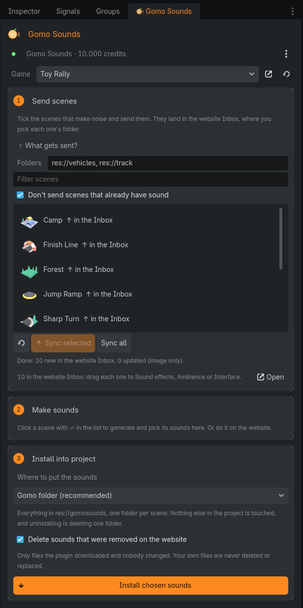
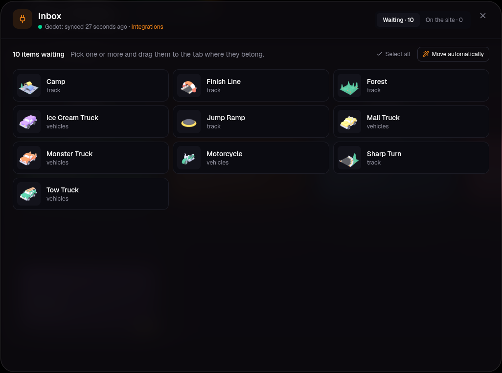
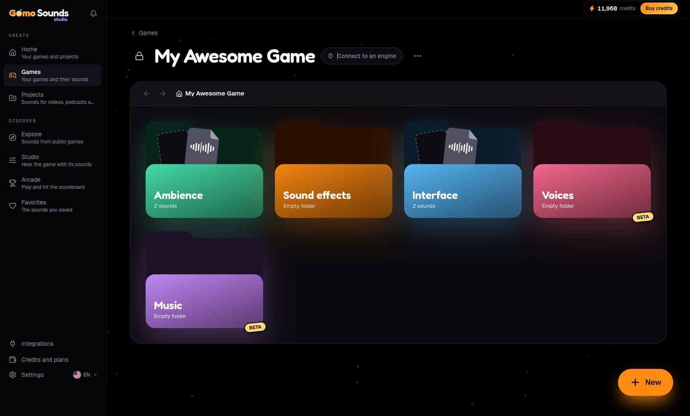
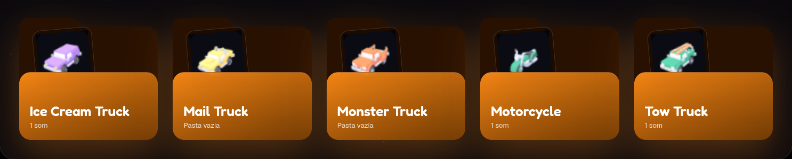
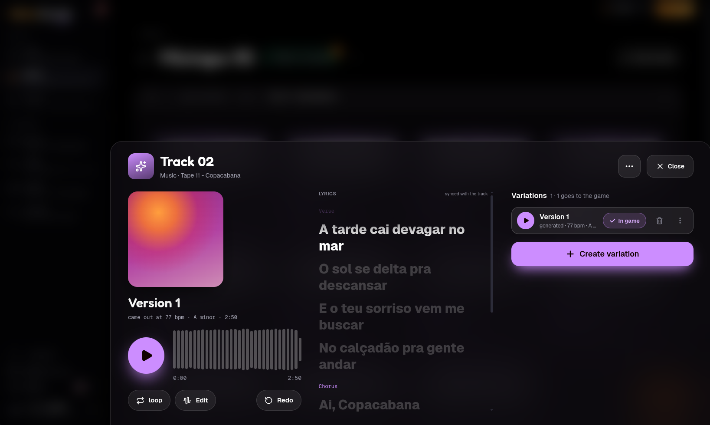

<h1 align="center">🍊 Gomo Sounds for Godot</h1>

<p align="center">
  <b>Sound effects, music and voices for your Godot game, made with AI and installed for you.</b><br>
  Describe a sound in words. Pick the version you like. Play it with one line of code.
</p>

<p align="center">
  <a href="https://gomosounds.com/en">Website</a> ·
  <a href="https://gomosounds.com/en/docs/godot">Docs</a> ·
  <a href="https://gomosounds.com/en/ai-game-music-generator">Hear the music styles</a> ·
  <a href="https://gomosounds.com/en/explore">Explore public sounds</a>
</p>

<p align="center">
  
  
  
  <a href="https://glama.ai/mcp/connectors/com.gomosounds/gomo-sounds"></a>
</p>

---

## What is this?

Every game needs a lot of sounds: a jump, a coin, a sword hit, a door, a menu click, the rain in the background, a
theme for the boss fight. Getting them usually means digging through sound packs, settling for "close enough",
renaming files, dragging them into the project and wiring an `AudioStreamPlayer` for each one.

**Gomo Sounds** does that work for you:

1. **You describe the sound** in plain words: *"slime jump"*, *"rusty door creaks open"*, *"calm forest at night"*.
2. **AI makes it.** You get several versions of each sound, and you keep the ones you like.
3. **This plugin brings them into your project**, already organized and imported (loops already set).
4. **One line plays it in the game.** Each time, the plugin picks one of the versions you kept and nudges the pitch,
   so the 100th footstep doesn't sound like the first.

You don't need to know anything about audio.

<p align="center">
  
  &nbsp;
  
</p>

## How it works

<p align="center"></p>

**1. Connect your project.** The plugin reads your scenes (the player, the enemies, the items...) and sends them to
the game's Inbox on Gomo Sounds. Drag each one to its tab (or click **Move automatically**) and it gets its own list
of sounds.

<p align="center"></p>

**2. Make the sounds.** Ask for "attack", "footsteps", "die" for each scene, from the Gomo Sounds dock in the editor
or on the website. Listen to the versions and keep the best ones. On the website you can also trim, fix and mix
them, and hear everything playing together as if the game were running.

**3. Install.** Click **Install chosen sounds**. The plugin shows exactly what will change (new, updated, moved or
removed files) before touching anything.

**4. Play.**

```gdscript
# Plays this scene's "Attack" sound (3D on a Node3D, 2D on a Node2D)
SfxLibrary.play_event(self, "Attack")

# Plays any sound by its folder and name
SfxLibrary.play("@interface/buttons.click", self)

# Plays a music track, crossfading between the versions you kept
SfxLibrary.play_music("@music.theme")
```

## Music, too

<p align="center"></p>

Describe the mood and pick a style, from chiptune and epic orchestral to lo-fi, metal and bossa nova. Tracks
come out looping or with a beginning and an end, instrumental or with lyrics (yours, or written by the AI). They
land in the game's Music folder and install like any other sound.
[Hear all the styles →](https://gomosounds.com/en/ai-game-music-generator)

## Quick start

You need **Godot 4.3 or newer** and a **free Gomo Sounds account**.

1. Copy the `addons/gomo_sounds` folder into your project, so it ends up at `res://addons/gomo_sounds`.
2. In Godot, open **Project → Project Settings → Plugins** and enable **Gomo Sounds**.
3. The **Gomo Sounds** dock appears on the right. Click **Connect**: your browser opens the website with a code
   (like `ABCD-EFGH`). Check that it matches the dock and approve.
4. Tick the scenes that make noise and click **Sync selected** (or **Sync all**). Then make your sounds and click
   **Install chosen sounds**.

The plugin also registers the `SfxLibrary` autoload, which is what plays the sounds in your game.

## Good to know

- **Your game works offline.** The sounds are normal files inside your project. The exported game never talks to
  Gomo Sounds.
- **Your key stays on your computer.** The editor never asks for your password. The key is saved in the editor
  settings on your machine, outside the project and its git repository.
- **Only what you choose is sent.** When you sync, each ticked scene's name and description, a small image
  (256 px) of it, its path and, when the game is created, the project name. Your sounds, scripts, models, textures
  and the scenes you didn't tick never leave the project.
- **Your edits are safe.** If you edit an installed sound, a new version from the website won't overwrite it.
  Moving files around inside Godot doesn't break anything either.
- **Teams and CI.** The linked game is saved in `project.godot`, so the whole team shares it. There's also a
  command line for build servers (see the [docs](https://gomosounds.com/en/docs/godot)).

## Pricing

The plugin works on **every plan, free included**. Generating sounds uses credits: the free plan gives you
**200 credits every month**, no card needed. Picking and installing sounds are always free.

You can use the sounds in commercial games on any plan (Steam, itch.io, mobile, consoles). On the free plan, credit
Gomo Sounds in your game. See [pricing](https://gomosounds.com/en) and the [terms](https://gomosounds.com/terms).

## Using an AI assistant?

Gomo Sounds also has an MCP server, so Claude, Claude Code or any MCP client can plan and make your game's sounds in
a conversation, and this plugin installs them. See the [MCP docs](https://gomosounds.com/en/docs/mcp) or the
[listing on Glama](https://glama.ai/mcp/connectors/com.gomosounds/gomo-sounds).

## Tests

`tests/run.sh` builds an isolated test project in `.godot-testbed` (never your game) and checks the install rules,
the editor and an exported build. It needs Godot 4.3 or newer on the `PATH` as `godot-4`, or set `GODOT`.

## License

The plugin's code is under the [MIT license](LICENSE). The sounds you make follow the
[Gomo Sounds terms](https://gomosounds.com/terms).
